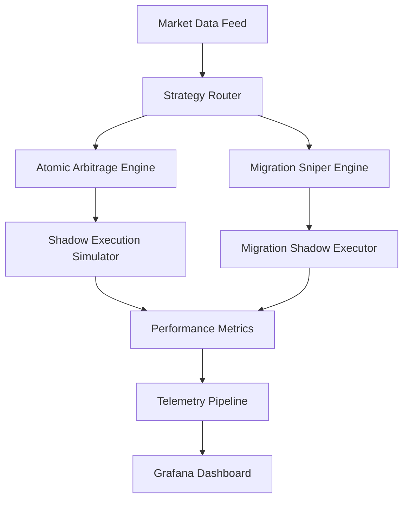

# Optimal Software Architecture for Zero-Risk Shadow Simulation Engine

## Executive Summary

For your Solana bot architecture, I recommend a **Modular Multi-Strategy Engine** approach with strict isolation between strategies. This provides superior risk management, enhanced learning opportunities, and better long-term scalability while maintaining the zero-risk constraint.

## 1. Software Architecture Decision Analysis

### Modular Multi-Strategy Engine ✅ RECOMMENDED

**Pros:**
- **Risk Diversification**: Isolated failure domains prevent one strategy's issues from affecting others
- **Cross-Validation**: Real-time performance comparison reveals genuine alpha vs market noise
- **Resource Efficiency**: Shared infrastructure (RPC connections, data feeds, monitoring) reduces overhead
- **Knowledge Transfer**: Insights from proven arbitrage can inform migration sniper development
- **Future-Proofing**: Easy to add new strategies without architectural rewrites
- **A/B Testing**: Direct comparison of execution quality and edge detection

**Cons:**
- **Initial Complexity**: Higher upfront design and implementation effort
- **Resource Contention**: Potential competition for RPC bandwidth or compute resources
- **Debugging Overhead**: More complex troubleshooting when issues arise

### Single-Purpose Pivot

**Pros:**
- **Simplicity**: Focused development with fewer moving parts
- **Performance Optimization**: Resources dedicated entirely to migration sniping
- **Faster MVP**: Quicker path to initial functionality

**Cons:**
- **Lost Learning**: Abandoning proven atomic arbitrage code eliminates valuable insights
- **No Baseline**: No reference point for evaluating migration sniper performance
- **Technical Debt**: Future multi-strategy expansion requires significant refactoring
- **Opportunity Cost**: Missing chance to identify cross-strategy synergies

## 2. High-Fidelity Shadow Simulation Design

### Core Architecture Components



### Key Simulation Fidelity Mechanisms

#### A. Transaction Execution Modeling
```rust
struct ShadowTransaction {
    timestamp: u64,
    program_id: Pubkey,
    accounts: Vec<Pubkey>,
    data: Vec<u8>,
    priority_fees: u64,
    compute_units: u32,
    estimated_confirmation_time: f64, // ms
    slippage_tolerance: f64, // percentage
}

impl ShadowExecutor {
    fn simulate_fill(&self, tx: &ShadowTransaction) -> ExecutionResult {
        let base_fill_rate = self.calculate_base_fill_probability(tx);
        let latency_adjustment = self.model_network_latency();
        let congestion_factor = self.assess_network_congestion();
        
        ExecutionResult {
            filled: self.rng.gen::<f64>() < (base_fill_rate * latency_adjustment * congestion_factor),
            slippage: self.calculate_realistic_slippage(tx),
            execution_time: self.model_realistic_execution_time(tx),
            fees_paid: self.estimate_priority_fees(tx)
        }
    }
}
```

#### B. Latency Simulation
- **Network Latency Modeling**: Simulate realistic RPC round-trip times (50-200ms)
- **Block Propagation Delays**: Account for 400ms average block confirmation time
- **Compute Unit Constraints**: Model actual CU limits and processing delays
- **Queue Position Effects**: Simulate transaction ordering impact

#### C. Slippage Engine
```rust
struct SlippageModel {
    market_depth_data: MarketDepthCache,
    volatility_metrics: VolatilityTracker,
    liquidity_profiles: HashMap<TokenPair, LiquidityProfile>
}

impl SlippageModel {
    fn calculate_impact(&self, order_size: f64, pair: &TokenPair) -> SlippageImpact {
        let depth_curve = self.market_depth_data.get_curve(pair);
        let volatility_multiplier = self.volatility_metrics.get_current_volatility(pair);
        
        SlippageImpact {
            price_impact: depth_curve.calculate_impact(order_size),
            volatility_adjustment: volatility_multiplier,
            confidence_interval: self.calculate_confidence_bounds(order_size)
        }
    }
}
```

#### D. Stop-Loss Execution Simulation
- **Price Monitoring Frequency**: Simulate realistic oracle update intervals
- **Execution Thresholds**: Model actual price deviation triggers
- **Fallback Mechanisms**: Simulate alternative exit routes and their reliability

## 3. Metrics & Dashboard Integration

### Unified Telemetry Pipeline

```yaml
telemetry_pipeline:
  sources:
    - strategy: "atomic_arb"
      metrics:
        - profit_and_loss
        - fill_rate
        - slippage_actual_vs_predicted
        - execution_latency
        - opportunity_cost
    
    - strategy: "migration_sniper"
      metrics:
        - target_detection_accuracy
        - fill_success_rate
        - slippage_realized
        - timing_precision
        - risk_adjusted_return

  processors:
    - normalizer: Standardizes metric formats
    - aggregator: Combines related metrics
    - anomaly_detector: Flags unusual patterns
    - correlation_analyzer: Identifies strategy interactions

  sinks:
    - prometheus_exporter: For Grafana integration
    - alert_manager: Critical threshold notifications
    - data_lake: Long-term storage for analysis
```

### Recommended Dashboard Structure

#### Main Overview Panel
- **Real-time P&L Comparison**: Side-by-side strategy performance
- **Risk Metrics**: Drawdown, Sharpe ratio, maximum adverse excursion
- **Execution Quality**: Fill rates, slippage, latency distributions

#### Strategy-Specific Panels

**Atomic Arbitrage Section:**
- Opportunity flow rate
- Profit per opportunity distribution
- Network condition impact analysis

**Migration Sniper Section:**
- Target identification accuracy
- Timing precision metrics
- Market impact analysis
- False positive/negative rates

#### Cross-Strategy Analytics
- Correlation heatmaps
- Resource utilization comparison
- Edge persistence analysis

## Implementation Roadmap

### Phase 1: Foundation (Weeks 1-2)
1. Establish modular architecture with strategy isolation
2. Implement high-fidelity simulation engines
3. Set up basic telemetry pipeline

### Phase 2: Strategy Integration (Weeks 3-4)
1. Port existing atomic arbitrage to shadow mode
2. Develop migration sniper simulation logic
3. Implement comprehensive metrics collection

### Phase 3: Dashboard & Refinement (Weeks 5-6)
1. Connect to existing Grafana instance
2. Fine-tune simulation parameters based on historical data
3. Implement advanced analytics and alerts

## Risk Mitigation Strategies

1. **Complete Isolation**: Strategies cannot share state or influence each other
2. **Deterministic Simulation**: All randomness seeded for reproducible testing
3. **Circuit Breakers**: Automatic shutdown on anomalous behavior detection
4. **Comprehensive Logging**: Full audit trail of all simulated decisions
5. **Regular Backtesting**: Continuous validation against historical market conditions

This architecture provides the foundation for building a robust, scalable trading system while maintaining the zero-risk requirement through sophisticated simulation rather than real capital exposure.